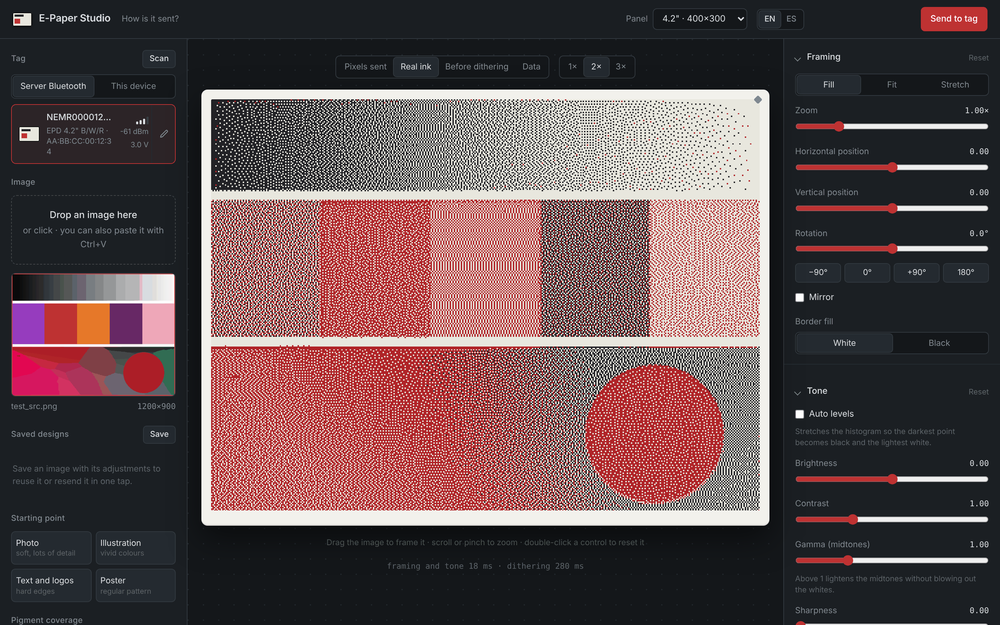
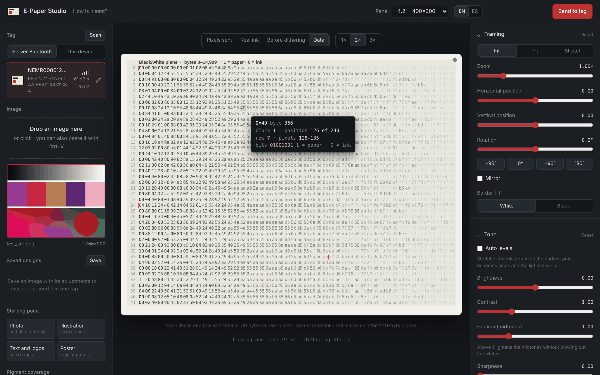
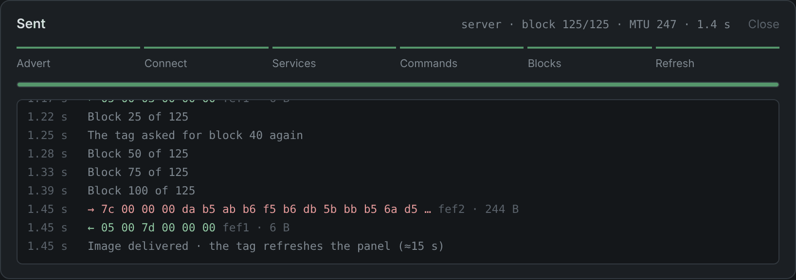
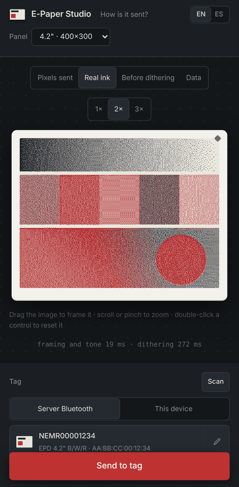

# E-Paper Studio

**Prepare images for Gicisky Bluetooth e-paper tags and send them straight from your computer or phone — no Home Assistant, no vendor app.**

Drop in any image, frame it, tune tone and colour, pick a dithering algorithm and watch, live, exactly what the panel will show. When it looks right, one tap sends it over Bluetooth Low Energy — through the server's adapter or the Bluetooth of the phone or laptop you are using. Available in English and Spanish.



## Features

- **Accurate preview.** Colour matching in OKLab against the *real* ink colours, gamut mapping so impossible colours (greens on a red panel) don't smear, and 9 dithering algorithms (Floyd–Steinberg, Atkinson, Jarvis-Judice-Ninke, Stucki, Burkes, Sierra, Sierra Lite, Bayer, none).
- **Two ways to send.** *Server Bluetooth*: the machine running E-Paper Studio talks to the tag through [Bleak](https://github.com/hbldh/bleak). *This device*: the browser talks to the tag itself with Web Bluetooth (Chrome/Edge on Android, Windows, macOS, Linux), so you can walk up to a tag with your phone. Same protocol, same live log of every packet, automatic retries.
- **Organised tags.** Give each tag a name and a group ("Kitchen", "Office"); they are remembered on the server and shown grouped.
- **Saved designs.** Keep an image together with all its adjustments, reopen it to tweak, or resend it in one tap.
- **Works on phones.** Touch-friendly layout, pinch to zoom, drag to frame.
- **See the bytes.** The *Data* view shows the exact buffer that will be uploaded, one panel row per line, with a tooltip that decodes any byte back into pixels.
- **Explained.** The bottom of the page walks through the whole journey — pixels → bit planes → BLE packets → refresh — using the numbers of *your* image.
- **Saves battery.** Warns you before re-sending an image the tag already shows.
- **Bilingual.** English (default) and Spanish, switchable live; the choice is remembered. Adding a language is two files ([how](#adding-a-language)).

| Data view | Upload log | On a phone |
|---|---|---|
|  |  |  |

## Compatible tags

Gicisky tags (often sold as "NEMR…" e-paper price tags) identify their model in the BLE advert.

| Model id | Panel | Size | Status |
|---|---|---|---|
| `0x004B` | EPD 4.2" B/W/R | 400×300 | Format verified* · reference device |
| `0x004E` | EPD 4.2" B/W/R/Y | 400×300 | Format verified* |
| `0x0033` | EPD 2.9" B/W/R | 296×128 | Format verified* |
| `0x0028` | EPD 2.9" B/W | 296×128 | Format verified* |
| `0x002E` | EPD 2.9" B/W/R/Y | 296×128 | Format verified* |
| `0x000B` | EPD 2.1" B/W/R | 212×104 | Format verified* |
| `0x010B` | EPD 2.1" B/W/R | 250×128 | Format verified* |
| `0x00A0` | TFT 2.1" B/W | 250×132 | Format verified* |
| `0x022B` | EPD 3.7" B/W/R | 240×416 | Format verified* |
| `0x012B` | EPD 7.5" B/W/R | 800×480 | ❌ Needs QuickLZ compression |
| `0x008B` | EPD 10.2" B/W/R | 960×640 | ❌ Needs QuickLZ compression |

\* The test suite checks that the bytes we produce are identical to those of [hass-gicisky](https://github.com/eigger/hass-gicisky) for that model. If you own one of these, a report (works / doesn't) is very welcome.

## Requirements

- Python 3.10+ on the machine that runs the server.
- For *Server Bluetooth*: Linux with BlueZ (`bluetoothd` running) and a Bluetooth 4.0+ adapter. Bleak also supports macOS and Windows, but only Linux has been tested.
- For *This device*: a browser with Web Bluetooth — Chrome or Edge on Android, Windows, macOS or Linux (on Linux desktop you may need to enable `chrome://flags/#enable-experimental-web-platform-features`). Safari and Firefox don't support it; on iPhone, the Bluefy browser does. The page must be served over **HTTPS** (see below) unless you open it on `localhost`.

## Install and run

With [uv](https://docs.astral.sh/uv/) (recommended):

```bash
git clone https://github.com/<YOUR USER>/epaper-studio
cd epaper-studio
uv run epaper-studio
```

With pip:

```bash
python -m venv .venv && . .venv/bin/activate
pip install .
epaper-studio          # or: python -m epaper_studio
```

Then open <http://localhost:8080>, choose **Server Bluetooth** and press **Scan** (or **This device** and **Add**), drop an image and press **Send to tag**. Tap the pencil next to a tag to name it, group it or set its model.

Command-line options: `--host`, `--port`, `--data-dir`, `--ssl-certfile`, `--ssl-keyfile`, `--env-file`, `--init` (writes a commented `.env`) and `--version`.

### HTTPS (needed for “This device” from a phone)

Browsers only allow Web Bluetooth on secure pages. `http://localhost` counts as secure, but `http://192.168.1.20:8080` on your phone does not, and the **This device** option will say so. Pick one:

- **Tailscale** (easiest if you use it): `tailscale serve --bg 8080` gives you `https://<machine>.<tailnet>.ts.net` with a real certificate.
- **mkcert**: create a local CA and a certificate for the server's IP, install the CA on the phone, and start with
  `SSL_CERTFILE=cert.pem SSL_KEYFILE=key.pem epaper-studio`:
  ```bash
  mkcert -install
  mkcert -cert-file cert.pem -key-file key.pem 192.168.1.20 epaper.local
  ```
- **A reverse proxy** you already run (Caddy, nginx, Traefik) with a certificate.
- **Quick test on Android**: in Chrome open `chrome://flags/#unsafely-treat-insecure-origin-as-secure`, add `http://192.168.1.20:8080` and restart Chrome.

### Where things are kept

Tag names and groups (`devices.json`) and saved designs (`designs/<id>/` with the source image, the settings and a thumbnail) are stored in `DATA_DIR`, by default `~/.local/share/epaper-studio`. Back up that folder to keep them; delete it to start over.

## Configuration

Settings come from environment variables or a `.env` file in the working directory (environment variables win). Run `epaper-studio --init` to create a commented one.

| Variable | Default | Meaning |
|---|---|---|
| `HOST` | `0.0.0.0` | Address to listen on. Use `127.0.0.1` to allow only this machine. |
| `PORT` | `8080` | HTTP port. |
| `TAG_ADDRESS` | *(empty)* | MAC of the tag preselected when the page opens. |
| `BLE_WRITE_DELAY_MS` | `0` | Pause between writes. Raise to 20–50 only if transfers keep dropping. |
| `DATA_DIR` | `~/.local/share/epaper-studio` | Where tag names and saved designs are kept. |
| `SSL_CERTFILE`, `SSL_KEYFILE` | *(empty)* | Serve over HTTPS with this certificate and key. |

### Running it as a service

```ini
# /etc/systemd/system/epaper-studio.service
[Unit]
Description=E-Paper Studio
After=bluetooth.target network-online.target

[Service]
WorkingDirectory=/opt/epaper-studio
ExecStart=/opt/epaper-studio/.venv/bin/epaper-studio
Restart=on-failure

[Install]
WantedBy=multi-user.target
```

## How it works

```
image ──► frame & tone ──► OKLab + gamut map ──► dither ──► bit planes ──► 240-byte blocks ──► BLE ──► panel refresh
         (Pillow)          (numpy)                         (packing.py)   (protocol.py)
```

The protocol in one paragraph: the tag exposes service `fef0`. Commands go to `fef1`, which also notifies replies; image data goes to `fef2`. `01` → `01 f4 00` (ready), `02 <size u32 LE> 00 00 00` → `02 …`, `03` → `05 00 <0>`; then each block `<n u32 LE><240 bytes>` is answered with `05 00 <next>`. The tag drives the pace and can ask for a block again. Full details in [docs/protocol.md](docs/protocol.md), and the app itself explains it at the bottom of the page.

### Project layout

```
src/epaper_studio/
├── cli.py, config.py     command line and settings (.env)
├── errors.py             StudioError: stable, translatable error codes
├── service.py            glue: image → packed bytes + stats for the UI
├── library.py            saved tag names/groups and designs (DATA_DIR)
├── imaging/              colour science, dithering, the image pipeline (no BLE)
├── gicisky/              model table, packing, BLE protocol, scanner (no HTTP)
└── web/
    ├── app.py            FastAPI routes
    ├── schemas.py, store.py
    └── static/           the UI: index.html, css/, js/ (ES modules), locales/
                          js/webble.js speaks the protocol from the browser
tests/                    pytest suite, simulated tag, reference digests
```

Layers only depend downwards: `web` → `service` → `imaging` / `gicisky`. The backend never sends sentences to the UI, only codes such as `{"code": "tag_not_seen", "params": {"seconds": 25}}`; the UI translates them.

### HTTP API

Interactive docs at `/api/docs`. Main endpoints: `POST /api/image` (raw image body) → `{id}`; `POST /api/render` → PNG preview (stats in the `X-Stats` header); `POST /api/packed` → the exact upload buffer; `GET /api/scan`; `POST /api/send` → `{job}`; `GET /api/jobs/{id}?since=n` to follow an upload; `GET|POST /api/devices`, `DELETE /api/devices/{key}` for named tags; `GET|POST /api/designs`, `PATCH|DELETE /api/designs/{id}`, `POST /api/designs/{id}/open` for saved designs.

## Troubleshooting

| Message | What to check |
|---|---|
| *bleak library is not installed* | You are running outside the project's environment. Use `uv run epaper-studio`. |
| *Bluetooth service (BlueZ/D-Bus) not found* | `systemctl status bluetooth`. In containers, D-Bus and the adapter must be reachable. |
| *adapter is powered off or blocked* | `rfkill list` → `rfkill unblock bluetooth`, then `bluetoothctl power on`. |
| *The tag was not seen* | The tag only advertises every few seconds. Move it closer and retry; make sure the phone app isn't connected to it. |
| Transfers stop halfway | Set `BLE_WRITE_DELAY_MS=30`. |
| *This device* is greyed out with an HTTPS note | Open the page over HTTPS or on localhost (see [HTTPS](#https-needed-for-this-device-from-a-phone)). |
| *This browser has no Web Bluetooth* | Use Chrome or Edge; on iPhone, Bluefy. |
| The tag was added but the model is unknown | Some browsers can't read adverts. Tap the pencil and choose the model; it is remembered. |
| *cannot send 244-byte blocks* | The phone's Bluetooth stack negotiated a small MTU. Try again, or use Server Bluetooth. |

**Proxmox / LXC:** an unprivileged container can't open Bluetooth sockets. Use a privileged container with the host network (`lxc.net.0.type: none`) and make sure only one `bluetoothd` runs (stop it on the host or in the container, not both). A VM with the USB adapter passed through also works.

## Security

There is no authentication. Anyone who can reach the port can upload images to your tags, rename them and see or delete your saved designs. Keep it on your LAN or bind it to `127.0.0.1` and put a reverse proxy with auth in front. Never expose it to the internet. Don't commit your `.env`.

## Development

```bash
uv sync                          # installs dev tools too
uv run pytest                    # tests, including a simulated tag
uv run ruff check .
uv run python tests/run_fake_server.py   # the UI against a fake tag, no hardware needed
```

See [CONTRIBUTING.md](CONTRIBUTING.md) for adding tag models or languages.

### Adding a language

1. Copy `src/epaper_studio/web/static/locales/en.json` to `<code>.json` and translate the values (keep the `{placeholders}`).
2. Copy `how.en.html` to `how.<code>.html` and translate the prose (keep every `id` and `data-live`).
3. Add the language to `LANGUAGES` in `static/js/i18n.js`.
4. `uv run pytest tests/test_i18n.py` checks that nothing is missing.

## Credits

The protocol knowledge and device table come from [hass-gicisky](https://github.com/eigger/hass-gicisky) by eigger (MIT). This project reimplements them as a standalone tool.

## Disclaimer

Not affiliated with Gicisky. Uploading images is what the tags are designed for, but you use this software at your own risk.

## License

[MIT](LICENSE)
